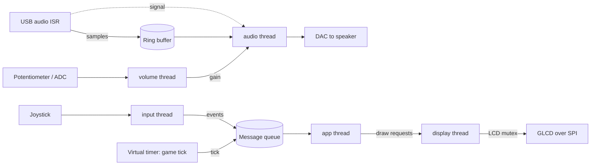

# Media center: architecture

This is the planned design. It will be revised as the firmware is built and measured.

## Threads and priorities

| Thread | Priority | Job | Blocks on |
| --- | --- | --- | --- |
| `audio` | High | Moves samples from the USB buffer to the DAC | Signal from the USB interrupt (buffer ready) |
| `input` | Above normal | Reads and debounces the joystick, sends events | `osDelay` (polls every 10 ms) |
| `app` | Normal | Runs the active app: menu, gallery or game logic | Message queue of input events and timer ticks |
| `display` | Normal | Owns all LCD drawing | LCD mutex and draw requests |
| `volume` | Low | Reads the potentiometer through the ADC | `osDelay` (every 50 ms) |

Plus the RTX timer thread, which runs the game-tick callback.

## Data flow

## Design rules

1. **Only audio runs at high priority, and it always blocks.** It waits on a signal from the USB interrupt between buffers, so it cannot starve the UI (Lab 3b).
2. **One owner for the LCD.** Only the display thread draws, behind an RTX mutex. RTX mutexes use priority inheritance, which avoids the inversion seen in Lab 4.
3. **Short timer callbacks.** The game-tick callback only posts a tick to the message queue. It never waits or draws (a lesson from my Lab 4 code).
4. **Interrupts do the minimum.** The USB ISR copies samples into the ring buffer and signals the audio thread. All other work happens in threads.
5. **Measure before claiming.** Every timing claim is checked in the RTX Event Viewer or with the DWT cycle counter (a lesson from Lab 2).

## Open questions

- Which sample rate and bit depth the DAC path can sustain while the LCD is busy.
- How many images fit in flash at full 320x240 colour (about 150 KB each at 16 bits per pixel), and whether to store them at lower resolution and scale up.
- Ring-buffer size versus the LPC1768's 64 KB of RAM, alongside thread stacks.
